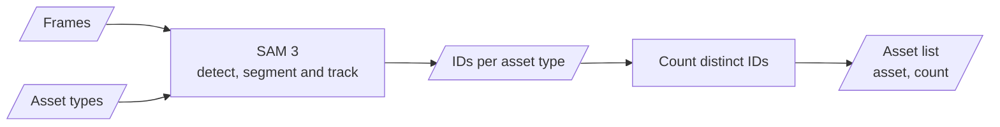

# Method 1: SAM 3 Room Different Asset Types

Status: 28-11-2026.

## 1. Overview

Method 1 is the first implementation of the method step of the evaluation pipeline (`pipeline-design.md`). Like every method, it receives the frames of a room video and a list of asset types from the pipeline and returns `counts.csv` with one count per asset type. The pipeline then evaluates these counts against the ground truth.

The method uses SAM 3 ("Segment Anything with Concepts", Meta), a model that finds objects in images and videos from a short text description, for example `door`. It runs locally on the GPU. In the prototype, it is used with its published weights, without additional training.

## 2. Working principle

For each asset type, SAM 3 detects, segments and tracks the matching objects across the video frames and assigns a unique ID to each tracked object. The count of an asset type is the number of distinct IDs.


## 3. How to run

```
conda activate sam3
cd /mnt/ssd/vladi/master-applied-it/3d-modelling
python code/run_pipeline.py sam3 room002
```

Program: `code/methods/sam3_video.py`. Besides `counts.csv`, it writes `method-stats.csv` (time and peak GPU memory per asset type) and `detect/<asset>/` with the detections and one folder of frames per ID.

## 4. Settings

| Setting | Value | Reason |
|---|---|---|
| Prompt | Asset type as text, at frame 0 | In the experiments, SAM 3 uses one text prompt per type. |
| Processes | One per asset type, two in parallel (one per GPU) | A failure stops only one asset type. |
| GPU memory | Frames stay in CPU memory | SAM 3 copied all frames to the GPU. The fix reduces the peak by 10.5 GB for room001. Peak per asset type: 6 to 12 GB, "door" in room001 18.8 GB. |

## 5. Results

| Run | Room | Correct | Too high | Too low | Time |
|---|---|---|---|---|---|
| exp016 | room001 (9 asset types) | 2 | 7 | 0 | 22.3 min |
| exp017 | room002 (10 asset types) | 3 | 6 | 1 | 12.9 min |

Difference per asset type (`evaluation.csv` of exp016 and exp017):

| Room | Asset type | Ground truth | Count | Difference |
|---|---|---|---|---|
| room001 | monitor | 2 | 4 | +2 |
| room001 | radiator | 1 | 2 | +1 |
| room001 | door | 1 | 12 | +11 |
| room001 | wall socket | 1 | 2 | +1 |
| room001 | light switch | 1 | 5 | +4 |
| room001 | office chair | 1 | 3 | +2 |
| room001 | wardrobe | 1 | 1 | +0 |
| room001 | bed | 1 | 1 | +0 |
| room001 | sofa | 1 | 2 | +1 |
| room002 | door | 2 | 9 | +7 |
| room002 | light switch | 2 | 5 | +3 |
| room002 | ceiling light | 2 | 2 | +0 |
| room002 | fire extinguisher | 1 | 2 | +1 |
| room002 | sink | 1 | 1 | +0 |
| room002 | water heater | 1 | 2 | +1 |
| room002 | expansion tank | 1 | 0 | -1 |
| room002 | wall socket | 3 | 5 | +2 |
| room002 | radiator | 1 | 1 | +0 |
| room002 | window | 2 | 13 | +11 |

## 6. Error analysis

Status: 28-11-2026. Analysed: "light switch" and "door" in room001 (exp016) and "window" in room002 (exp017). These are the three largest errors. The other asset types are not analysed.

Each ID was assigned one label from a picture sheet with six frames of the ID and from the box overlap (IoU) between IDs in shared frames. The labels are stored in `runs/exp016-room001-sam3/analysis/labels.csv` and `runs/exp017-room002-sam3/analysis/labels.csv`.

| Label | Meaning |
|---|---|
| correct | The first ID on an asset that the ground truth counts. |
| duplicate | An ID on an asset that already has an ID. |
| reflection | An ID on a mirror image of an object. |
| wrong object | An ID on an object of another type. |
| outside the room | An ID on an object of the right type outside the room, seen through a window. |

| Room | Asset type | IDs | Correct | Duplicate | Reflection | Wrong object | Outside the room | Missed |
|---|---|---|---|---|---|---|---|---|
| room001 | light switch | 5 | 1 | 1 | 1 | 2 | 0 | 0 |
| room001 | door | 12 | 1 | 1 | 2 | 8 | 0 | 0 |
| room002 | window | 13 | 2 | 1 | 0 | 0 | 10 | 0 |
| | Total | 30 | 4 | 3 | 3 | 10 | 10 | 0 |

Conclusions:

1. **Wrong objects cause 10 of the 26 extra IDs, and about half of them are caused by the prompt.** Five are objects of the right type that are not building assets: four wardrobe doors and a door in a picture on the wall. The prompt "door" does not make this distinction. The other five are not doors or light switches (radiator, cardboard, wall, paper and one ID that moves across furniture and a calendar). These are detection errors.
2. **Objects outside the room cause 10 of the 26 extra IDs, and all of them are caused by the prompt.** All 10 are windows of the houses across the street, seen through the window of room002. They are real windows and visible in the video. The prompt "window" cannot restrict the detection to the windows of the room. Their boxes are small: at most 0.14 % of the image, compared with 7 to 17 % (median) for the windows of the room. Five of the ten were checked on the picture sheet. The other five were assigned by box size.
3. **A mirror causes extra IDs.** The wardrobe mirror in room001 caused 3 of the 26 extra IDs: two on the mirror door ("door") and one on the mirror image of the switch plate ("light switch").
4. **Duplicates cause only 3 of the 26 extra IDs and occur in two forms.** Door: the track of the door is lost (frames 1289 to 1469) and a new ID appears on the same door. Window: the first ID of the narrow pane is absent from frame 297 to 817 (except frame 727), and a second ID follows the pane from frame 562. Light switch: two IDs follow the same object at the same time (median IoU 0.96 in 29 shared frames).
5. **Some IDs move from one object to another (ID switch).** One label per ID therefore simplifies the result. The table uses the object on which the ID is found in most frames.
6. **No asset of the three analysed types was missed.**

Limitation: three asset types in two rooms, chosen because they have the largest errors. The results do not show whether the same causes dominate for the asset types with small errors.

Summary:

1. **The method counts too many objects, not too few.** An improvement must remove IDs, not find more objects.
2. **Most extra IDs are objects of the right type that are not assets of the room**, for example windows outside the room, wardrobe doors and pictures. A text prompt alone cannot separate them. This is the first problem to address.
3. **Detection errors on other objects and reflections are a smaller part.** They are the second problem to address.
4. **Duplicates from tracking are rare.** Merging IDs has a low priority.
5. **Some causes leave measurable traces in the detections.** Windows outside the room have very small boxes. Duplicates overlap with another ID or appear when the first ID is lost. Such traces can be tested as filters on the existing detections without running SAM 3 again.


## 7. Recommendations

The next experiments focus on one asset type, the **fire extinguisher**. It has fewer variations and more distinctive features than doors and windows, and the problem analysis names it as a key asset. The test data must be extended with videos of rooms or floors that contain several fire extinguishers, because room002 contains only one. Signs with a fire extinguisher pictogram are expected to cause wrong detections, as the extra ID in room002 shows.
