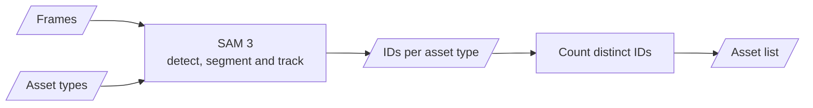

# Method 1: SAM 3

Status: 26-11-2026. Method step of the evaluation pipeline (`pipeline-design.md`).

## 1. Working principle

For each asset type, SAM 3 detects, segments and tracks the matching objects across the video frames and assigns a unique ID to each tracked object. The count of an asset type is the number of distinct IDs.



## 2. Settings

| Setting | Value | Reason |
|---|---|---|
| Frames | 10 frames per second, 1920 x 1080 px (videos: 3840 x 2160 px) | Small motion between frames helps the tracker. |
| Prompt | Asset type as text, at frame 0 | SAM 3 needs one text prompt per type. |
| Processes | One per asset type, two in parallel (one per GPU) | A failure stops only one asset type. |
| GPU memory | Frames stay in CPU memory | SAM 3 copied all frames to the GPU. The fix reduces the peak by 10.5 GB for room001. Peak per asset type: 6 to 12 GB, "door" in room001 18.8 GB. |

## 3. Results

| Run | Room | Correct | Too high | Too low | Time |
|---|---|---|---|---|---|
| exp016 | room001 (9 asset types) | 2 | 7 | 0 | 22.3 min |
| exp017 | room002 (10 asset types) | 3 | 6 | 1 | 12.9 min |

Largest errors: "door" +11 (room001) and "window" +11 (room002). In exp011, the 9 "door" IDs in room002 were checked one by one: 2 correct, 2 duplicate and 5 false detections.

## 4. Known errors

1. **False detection:** a window, wall or water heater is detected as a door.
2. **Duplicate:** an object receives a new ID when it returns into view.
3. **ID moves:** an ID moves from the object to another object.
4. **Missed object:** for example the expansion tank.

## 5. How to run

```
conda activate sam3
cd /mnt/ssd/vladi/master-applied-it/3d-modelling
python code/run_pipeline.py sam3 room002
```

Program: `code/methods/sam3_video.py`. Besides `counts.csv`, it writes `method-stats.csv` (time and peak GPU memory per asset type) and `detect/<asset>/` with the detections and one folder of frames per ID.
