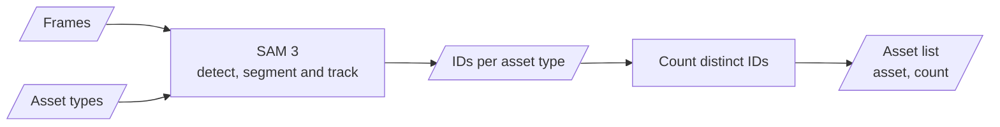

# Method 1: SAM 3

Status: 26-11-2026.

## 1. Overview

Method 1 is the first implementation of the method step of the evaluation pipeline (`pipeline-design.md`). Like every method, it receives the frames of a room video and a list of asset types from the pipeline and returns `counts.csv` with one count per asset type. The pipeline then evaluates these counts against the ground truth.

The method uses SAM 3 ("Segment Anything with Concepts", Meta), a model that finds objects in images and videos from a short text description, for example `door`. It runs locally on the GPU. In the prototype, it is used with its published weights, without additional training.

## 2. Working principle

For each asset type, SAM 3 detects, segments and tracks the matching objects across the video frames and assigns a unique ID to each tracked object. The count of an asset type is the number of distinct IDs.



## 3. Settings

| Setting | Value | Reason |
|---|---|---|
| Prompt | Asset type as text, at frame 0 | In the experiments, SAM 3 uses one text prompt per type. |
| Processes | One per asset type, two in parallel (one per GPU) | A failure stops only one asset type. |
| GPU memory | Frames stay in CPU memory | SAM 3 copied all frames to the GPU. The fix reduces the peak by 10.5 GB for room001. Peak per asset type: 6 to 12 GB, "door" in room001 18.8 GB. |

## 4. Results

| Run | Room | Correct | Too high | Too low | Time |
|---|---|---|---|---|---|
| exp016 | room001 (9 asset types) | 2 | 7 | 0 | 22.3 min |
| exp017 | room002 (10 asset types) | 3 | 6 | 1 | 12.9 min |

Difference per asset type (`evaluation.csv` of exp016 and exp017):

| Room | Asset type | Ground truth | Count | Difference |
|---|---|---|---|---|
| room001 | monitor | 2 | 4 | +2 |
| room001 | radiator | 1 | 2 | +1 |
| room001 | door | 1 | 12 | +11 |
| room001 | wall socket | 1 | 2 | +1 |
| room001 | light switch | 1 | 5 | +4 |
| room001 | office chair | 1 | 3 | +2 |
| room001 | wardrobe | 1 | 1 | +0 |
| room001 | bed | 1 | 1 | +0 |
| room001 | sofa | 1 | 2 | +1 |
| room002 | door | 2 | 9 | +7 |
| room002 | light switch | 2 | 5 | +3 |
| room002 | ceiling light | 2 | 2 | +0 |
| room002 | fire extinguisher | 1 | 2 | +1 |
| room002 | sink | 1 | 1 | +0 |
| room002 | water heater | 1 | 2 | +1 |
| room002 | expansion tank | 1 | 0 | -1 |
| room002 | wall socket | 3 | 5 | +2 |
| room002 | radiator | 1 | 1 | +0 |
| room002 | window | 2 | 13 | +11 |

The causes of the differences are not analysed yet.

## 5. How to run

```
conda activate sam3
cd /mnt/ssd/vladi/master-applied-it/3d-modelling
python code/run_pipeline.py sam3 room002
```

Program: `code/methods/sam3_video.py`. Besides `counts.csv`, it writes `method-stats.csv` (time and peak GPU memory per asset type) and `detect/<asset>/` with the detections and one folder of frames per ID.
