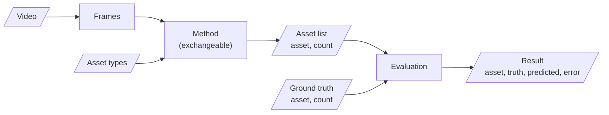

# Pipeline Design

Status: 26-11-2026.

## 1. Overview

The pipeline evaluates how accurately a method counts the assets in an RGB video of a room. The input is a video of one room and a list of asset types, for example `door` and `radiator`. The pipeline extracts frames from the video and passes them to a method, which outputs the number of objects per asset type. The pipeline then compares these counts with a ground truth that was counted by hand and reports the error per asset type.

The method is exchangeable. All methods run on the same rooms with the same evaluation, so that their results can be compared.

## 2. Evaluation pipeline

| Step | Decription |
|---|---|
| Frames | `frames/`: FFmpeg extracts 10 frames per second from the video, scales them to 1920 x 1080 px and saves them as JPEG files `00000.jpg`, `00001.jpg` and so on. The original videos have about 30 frames per second, so every third frame is kept. |
| Method | `counts.csv`: the method receives the frames and the list of asset types and writes one row `asset,count` per asset type. It runs as a separate program in its own software environment. An empty count means that the method failed for this asset type. |
| Evaluation | `evaluation.csv`: the pipeline matches the asset types of `counts.csv` and the ground truth by name and writes one row `asset,truth,predicted,error` per asset type in the ground truth, with `error = predicted - truth`. An asset type without a count gets an empty error. |

A positive error means too many objects, for example false detections or one object counted twice. A negative error means missed objects. Errors in both directions can cancel out.

## 3. Rules

1. A new method writes the same asset list format. The other steps do not change.
2. Each run has its own folder `runs/exp<NNN>-<room>-<method>` and is never overwritten.
3. Each room folder `data/<room>/` contains `video.mp4`, `asset-types.csv` and `ground-truth.csv`. The ground truth is counted by hand in the video.
4. One command runs the pipeline: `python code/run_pipeline.py <method> <room>`.

## 4. Test data

| Room | Video | Asset types in the ground truth |
|---|---|---|
| room001 | Student room, 173 s | 9 |
| room002 | Drying room and hallway in a house, 86 s | 10 |

## 5. Methods

| Method | Approach | Status |
|---|---|---|
| 1. SAM 3 (`method-1-sam3.md`) | Text prompt per asset type, video tracking, count = number of IDs | Runs on both rooms. Counts are mostly too high. |

Paused: 3D reconstruction with COLMAP (`code/methods/colmap.sh`), stopped on 19-11-2026 because it took more than 2 h for one room.

## 6. Open questions

1. How can false detections be reduced (prompt, score limit, other detector)?
2. How can duplicate IDs of one object be merged?
