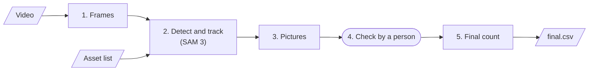

# Prototype Design

Version 1, 25-11-2026. Decisions and their reasons: `system-architecture.md`.

## 1. Purpose

The prototype supports a person who makes an inventory of a room. SAM 3 proposes objects from a video. The person checks the proposals. Only confirmed objects are counted.

## 2. Input and output

| | File | Content |
|---|---|---|
| Input | Video | RGB video of one room |
| Input | Asset list (CSV) | Header row, then one asset type per row |
| Input | Ground truth (CSV) | `prompt,count`. Used only for evaluation, but required by the current script. |
| Output | `final.csv` | `asset,count` after the check by a person |

## 3. Process



| Step | Performed by | Description | Result |
|---|---|---|---|
| 1. Frames | Computer | FFmpeg extracts 10 images per second, 1920 px wide. | `frames/` |
| 2. Detect and track | Computer | SAM 3 searches for each asset type by name. Each object that it finds receives an ID. Each asset type runs in its own process and two run in parallel, one per GPU. | `detect/<asset>/detections.csv` and one folder of images per ID |
| 3. Pictures | Computer | `review.py` saves one picture per ID. Left: largest view when the object was first seen. Right: largest view in the whole video. | `review/` |
| 4. Check | Person | The person writes a verdict for each ID in `review.csv`. If the two views differ, the left view is judged. | Completed `review.csv` |
| 5. Final count | Computer | `finalize.py` counts the IDs marked as correct. | `final.csv` |

For evaluation, `count.py` and `evaluate.py` also compare the number of IDs before the check with the ground truth.

## 4. Verdicts

| Verdict | Meaning |
|---|---|
| `correct` | The object is of this asset type and was not counted before. |
| `duplicate` | The object was already marked as correct under another ID. |
| `wrong` | The object is not of this asset type. |
| `NOTHING FOUND` | Written by the computer. The final count is 0. |
| `DETECTION FAILED` | Written by the computer. The final count is empty. |

`finalize.py` stops with an error if a verdict is missing or unknown.

## 5. How to use

```
conda activate sam3
cd /mnt/ssd/vladi/master-applied-it/3d-modelling
code/run_mvp.sh <video> <asset-list.csv> <ground-truth.csv> runs/<run> 2>&1 | tee runs/<run>.log
```

Complete `runs/<run>/review/review.csv`, then write the final list:

```
python3 code/stages/review/finalize.py runs/<run>/review/review.csv runs/<run>/final.csv
```

## 6. Result so far

"door" in room002 (exp011): SAM 3 found 9 objects. The person marked 2 as correct, 2 as duplicate and 5 as wrong. The final count is 2, equal to the hand count. The complete process, including the check, has been used for this asset type only.

## 7. Limitations

1. Objects that SAM 3 misses are not in the final list and the person cannot add them (example: expansion tank in exp010).
2. The time needed for the check is not measured. It is not known whether the prototype saves time.
3. The ground truth is required as input although a new room has none.
4. One run processes one room. There is no count per floor.
5. The prototype was tested in two rooms. The check was done by the developer, not by an inspector.
