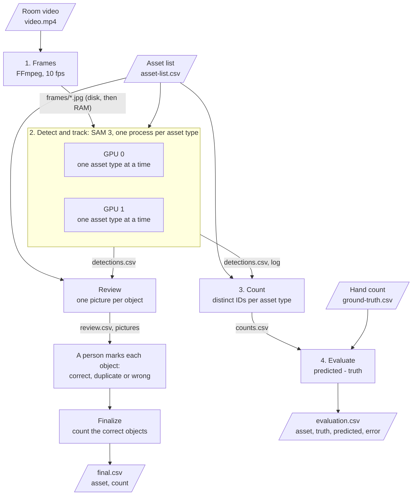

# System Architecture

Status: 25-11-2026. Prototype: `prototype-design.md`. Details: `architecture-details.md`.

## 1. Goal

Input: a room video and a list of asset types. Output: how many of each asset were found, compared with a hand count if one exists.

## 2. Data flow

`code/run_mvp.sh` runs all steps up to the review pictures. After the manual check, `code/stages/review/finalize.py` writes the final list.

| Step | What it does |
|---|---|
| Frames | Extracts 10 images per second from the video. |
| SAM 3 | Finds and tracks every object that matches an asset name. Each object gets an ID. |
| Count | Counts the distinct IDs per asset type. |
| Review | Saves one picture per object. A person fills in `review.csv`. |
| Finalize | Counts the objects marked as correct. |
| Evaluate | Writes `asset,truth,predicted,error`. |

## 3. Decisions in chronological order

| # | Date | Run | What happened | Decision and drawback |
|---|---|---|---|---|
| 1 | 18-11 or earlier | Before exp001 | The methods need different environments. | Steps run separately and exchange files. Runs are never overwritten. Drawback: more files. |
| 2 | 19-11 | After exp001 | COLMAP took more than 2 h. Heijmans needs counts, not positions. | **No 3D model for now.** SAM 3 is tested alone. Drawback: nothing links two views of the same object. |
| 3 | 19-11 | exp002 | SAM 3 tracks better when motion between frames is small. | Frames at 10 fps and 1920 px wide. Drawback: more frames cost more time and memory. |
| 4 | 19-11 | exp002 | SAM 3 gives each tracked object an ID. | **Count = number of distinct IDs.** Drawback: it over-counts when an object gets a second ID ("monitor": 4 instead of 2). |
| 5 | 19-11 | After exp004 | Several asset types in one process ran out of GPU memory (exp003, exp004). | One process per asset type. In exp005, 9 of 11 completed and 3 of 9 counts were correct. Drawback: the model is loaded again for every asset type. |
| 6 | 23-11 | After exp005 | Heijmans needs only the types in its asset table. | **The asset list is given as input.** Drawback: other types are not found. |
| 7 | 23-11 | After exp005 | A crashed run leaves partial data, which looks like a valid count. | A failed detection gives an empty count. |
| 8 | 24-11 | After exp005 | The errors have different directions and causes. | **Measure = signed count error per asset.** Drawback: errors can cancel out, so the images must be checked. |
| 9 | 24-11 | exp006 | The steps were started by hand. | One command runs all steps (`code/run_mvp.sh`). All 3 asset types in exp006 ran out of GPU memory. |
| 10 | 25-11 | exp007 | SAM 3 copied all frames to the GPU (10.5 GB). | Frames stay in RAM and one frame at a time goes to the GPU. The peak for "monitor" fell from 21.1 to 10.6 GB with identical detections. |
| 11 | 25-11 | exp007 | The memory fix changes one SAM 3 function. | The function is replaced at runtime, so `external/sam3` stays unmodified. Drawback: a new SAM 3 version can break it. |
| 12 | 25-11 | exp008 | The fix leaves enough memory on both GPUs. | Two asset types run in parallel, one per GPU. "door" and "cardboard box" are omitted. |
| 13 | 25-11 | exp009 | Wrong input: `assets-to-find.csv` listed the room001 assets, so the run used the ground-truth list. | Run stopped by the architect. No results. The number is not reused. |
| 14 | 25-11 | exp010 | First run on room002 (10 asset types). "door" and "window" crashed because SAM 3 returned an object with an empty mask. | Objects with an empty mask get no overlay. Checked outside a run: both asset types complete ("door" 9 IDs, "window" 13 IDs). |
| 15 | 25-11 | After exp010 | SAM 3 found 3 power sockets, the hand count was 2. The third socket is visible in the video. | The hand count was corrected to 3. With this correction, exp010 has 4 exact counts of 8 completed. `evaluation.csv` still contains the old value. |
| 16 | 25-11 | exp011 | "door" only, all visible frames saved per ID. 9 IDs for 2 doors: wrong objects, second IDs and IDs that move to another object. | One asset type per experiment. The architect starts the experiments. |
| 17 | 25-11 | After exp011 | Detection errors and tracking errors are mixed in the count. | **Detection is improved first, on single images without tracking.** Test set: 43 images of room002, one every 2 s, marked by hand before the SAM 3 boxes are seen. Drawback: one video only. |
| 18 | 25-11 | After exp011 | It was not defined what counts as a door. | A partly visible door and a door seen through a doorway count. A doorway without a door does not count. |
| 19 | 25-11 | exp012 | SAM 3 on 43 single images: all 8 certain doors found, 15 wrong boxes at a score limit of 0.5 (verdicts by Claude, not checked). | **Finish the prototype first:** it shows a picture of each detected object and a person removes the wrong ones. Better detection comes later. Drawback: missed objects are not shown. |
| 20 | 25-11 | exp011 | SAM 3 found 9 doors. The architect checked one picture per object: 2 correct, 2 duplicate, 5 wrong. The final count is 2, equal to the hand count. | **The final list contains only objects that a person marked as correct** (`review.py`, `finalize.py`). Drawback: objects that SAM 3 missed cannot be added. The time needed for the check is not measured yet. |

Bold: decisions that have the largest effect on the results.

## 4. Known problem

Counts are often wrong: in exp005, 3 of 9 completed assets were correct, 5 were too high and 1 was too low. In exp010 (room002), 4 of 8 completed assets were correct after correction of the hand count, 3 were too high and 1 was too low.

## 5. Open decisions

1. Which rule reduces wrong counts? Decide after checking the images.
2. Are camera poses needed to merge duplicate IDs? Decide only if a simple rule is not sufficient.
